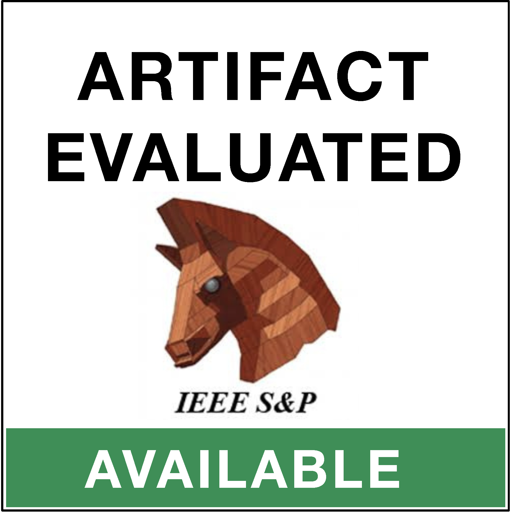
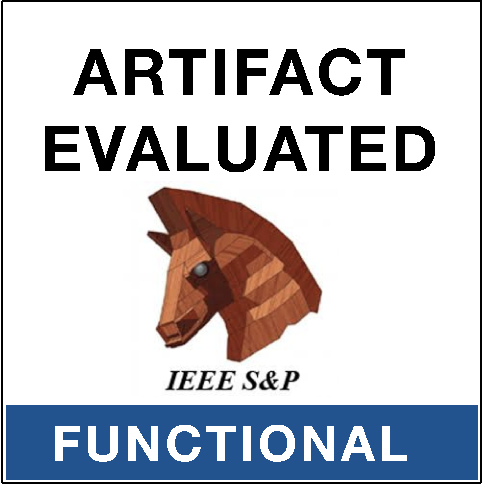
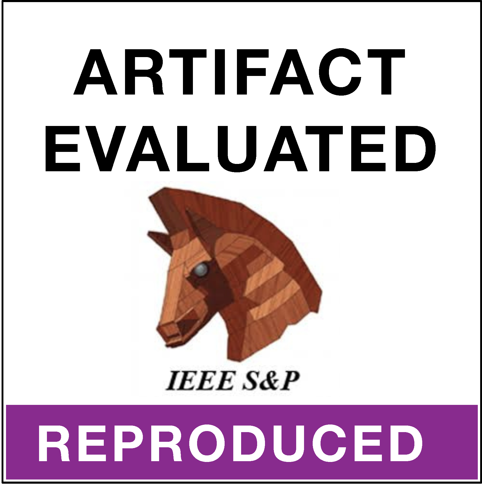

# Split-View PDFs

This repository contains the public samples and validation code for *What Users See Is Not What Models Read: Split-View PDFs in Document-to-LLM Supply Chain*, accepted at the 2027 IEEE Symposium on Security and Privacy (IEEE S&P 2027). 

[Full paper](https://arxiv.org/pdf/2606.15020), [Demo](https://sd957.github.io/split-view-pdf/)

<p align="left">
  
  
  
</p>

## Repository Structure

| Path | Contents |
| --- | --- |
| `corpus_a/` | 25 minimal extraction-gap PDFs and their parser PNG/TXT outputs. |
| `corpus_b/primary_25/` | 25 downstream LLM evaluation PDFs and corresponding PNG/TXT views. |
| `corpus_b/qa_adapted_11/` | 11 additional QA-adapted PDFs and corresponding PNG/TXT views. |
| `parser_validation/` | Runner for the open-source PDF parsers evaluated in the paper. |
| `llm_validation/` | API and Web validation instructions for the evaluated LLM platforms. |

## Parser Validation

On Ubuntu, install Python 3.10+, Java, Poppler, Ghostscript, npm, and Node.js
20.16 or newer. Then run:

```bash
cd parser_validation
./setup.sh --core
./run.sh ../corpus_a/pdfs/EG_001_canary.pdf
```

Use `./setup.sh --all` to install the optional text-extraction pipelines, or
pass the `corpus_a/pdfs` directory to process all 25 samples. Outputs are saved
under `parser_validation/outputs/`. See
[`parser_validation/README.md`](parser_validation/README.md) for details.

## LLM Validation

Automated validation requires provider API credentials and may incur charges:

```bash
cd llm_validation
./setup.sh
cp .API_KEY.example .API_KEY
./run.sh --suite primary --providers gpt --limit 1 --dry-run
./run.sh --suite primary --providers gpt --limit 1 --repeats 1
```

Reviewers without API access can upload a PDF from `corpus_b/primary_25/pdfs/`
directly to a supported Web chat interface and compare the answer with its
precomputed PNG/TXT views. See
[`llm_validation/README.md`](llm_validation/README.md) for prompts and
provider options.

## Citation

```bibtex
@inproceedings{SplitViewPDF,
  author = {Side Liu and Jiang Ming},
  title = {{What Users See Is Not What Models Read: Split-View PDFs in Document-to-LLM Supply Chains}},
  booktitle = {Proceedings of the 48th IEEE Symposium on Security and Privacy (S\&P '27)},
  year = {2027}
}
```
